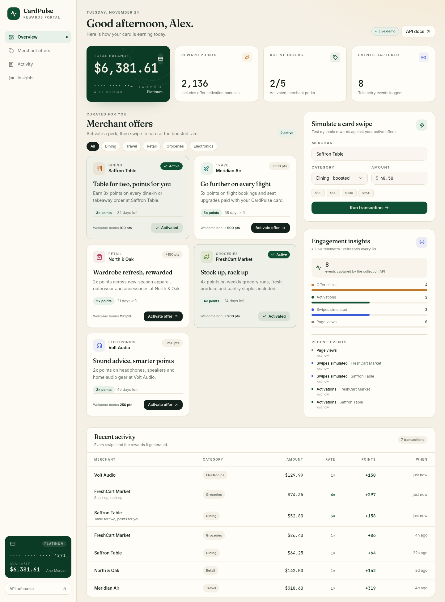
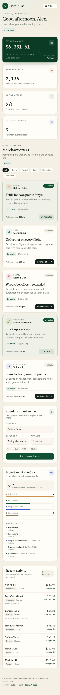

# CardPulse

**Smart merchant offers & rewards portal** — a production-clean full-stack demo built with FastAPI, SQLite/SQLAlchemy, React (Vite) and Tailwind CSS.




---

## What it does

- **Merchant offers** across Dining, Travel, Retail, Groceries and Electronics, with one-click activation and welcome bonuses.
- **Dynamic rewards engine** — a card swipe earns the best active multiplier for its merchant category, or the base 1× rate when no offer is active.
- **Live telemetry** — every offer click, activation and simulated swipe is streamed to `POST /api/v1/telemetry` and aggregated into an engagement panel.
- **Real-time dashboard** — balance, points, active offers, event counts, offer grid, swipe simulator and recent activity, all backed by the REST API.
- **OpenAPI docs** generated automatically at `/docs` and `/redoc`.
- **Seeded demo data** on first boot, plus a pytest suite and GitHub Actions CI.

---

## Architecture

```text
┌──────────────────────────────────┐          ┌────────────────────────────────────┐
│ React 18 + Vite + Tailwind       │   REST   │ FastAPI                            │
│ http://localhost:5173            │  JSON    │ http://localhost:8000              │
│                                  │ ───────► │                                    │
│  · Dashboard & offer grid        │          │  /api/v1/offers                    │
│  · Swipe simulator               │ ◄─────── │  /api/v1/transactions              │
│  · Engagement insights           │          │  /api/v1/telemetry                 │
│  · Telemetry (keepalive fetch)   │          │  /api/v1/account                   │
└──────────────────────────────────┘          └─────────────────┬──────────────────┘
                                                                │ SQLAlchemy 2.0
                                                                ▼
                                                ┌────────────────────────────────────┐
                                                │ SQLite · backend/cardpulse.db      │
                                                │ accounts · offers · transactions · │
                                                │ analytics_events                   │
                                                └────────────────────────────────────┘
```

### Project layout

```text
cardpulse-rewards-platform/
├── backend/
│   ├── app/
│   │   ├── main.py              # FastAPI app, CORS, lifespan, seeding
│   │   ├── database.py          # engine, session factory, Base
│   │   ├── models.py            # Account, Offer, Transaction, AnalyticsEvent
│   │   ├── schemas.py           # Pydantic request/response models
│   │   ├── seed.py              # 5 offers + sample transactions
│   │   └── routers/
│   │       ├── account.py
│   │       ├── offers.py
│   │       ├── transactions.py
│   │       └── telemetry.py
│   ├── tests/
│   │   ├── conftest.py          # isolated test database + seeded client
│   │   └── test_api.py          # activation, rewards, telemetry, health
│   ├── requirements.txt
│   └── pytest.ini
├── frontend/
│   ├── src/
│   │   ├── App.jsx              # dashboard orchestration & interactions
│   │   ├── api.js               # REST helpers + telemetry sender
│   │   ├── utils.js             # formatting helpers
│   │   └── components/          # Sidebar, StatCards, OfferCard, SwipeForm,
│   │                            # InsightsPanel, TransactionsTable, Toast
│   ├── index.html
│   ├── tailwind.config.js
│   └── vite.config.js
├── docs/
│   ├── dashboard.png
│   └── dashboard-mobile.png
├── .github/workflows/ci.yml
└── README.md
```

---

## Quickstart

### Prerequisites

- Python **3.10+**
- Node.js **18+** (Node 20 recommended) and npm

### Terminal 1 — backend API

```bash
cd cardpulse-rewards-platform/backend
python3 -m venv .venv
source .venv/bin/activate
pip install -r requirements.txt
uvicorn app.main:app --reload --port 8000
```

- API root: <http://localhost:8000>
- Swagger UI: <http://localhost:8000/docs>
- ReDoc: <http://localhost:8000/redoc>
- OpenAPI JSON: <http://localhost:8000/openapi.json>

### Terminal 2 — frontend dashboard

```bash
cd cardpulse-rewards-platform/frontend
npm install
npm run dev
```

Open <http://localhost:5173>.

> **Windows PowerShell:** activate the backend virtualenv with `.venv\Scripts\Activate.ps1` instead of `source .venv/bin/activate`.

### Production build (optional)

```bash
cd cardpulse-rewards-platform/frontend
npm run build
npm run preview   # serves the built app on http://localhost:4173
```

The preview origin is already allowed by the API's CORS configuration.

### Reset demo data

Stop the backend, delete the SQLite file, and start it again — the database is recreated and seeded automatically.

```bash
rm backend/cardpulse.db
```

---

## Configuration

| Variable | Where | Default | Purpose |
| --- | --- | --- | --- |
| `DATABASE_URL` | backend process | `sqlite:///./cardpulse.db` | SQLAlchemy database URL. Point at Postgres/MySQL without code changes. |
| `VITE_API_BASE_URL` | frontend build/runtime | `http://localhost:8000` | API origin used by the dashboard. |

Example:

```bash
DATABASE_URL="sqlite:///./cardpulse.db" uvicorn app.main:app --reload --port 8000
```

```bash
VITE_API_BASE_URL="http://localhost:8000" npm run dev
```

Copy `.env.example` files if you prefer local env files. The frontend reads `VITE_*` variables at build time.

---

## Demo data

The first startup seeds one cardholder account, five offers and four sample transactions.

| Merchant | Category | Multiplier | Welcome bonus | Validity |
| --- | --- | --- | --- | --- |
| Saffron Table | Dining | 3× | 100 pts | 32 days |
| Meridian Air | Travel | 5× | 500 pts | 58 days |
| North & Oak | Retail | 2× | 150 pts | 21 days |
| FreshCart Market | Groceries | 4× | 200 pts | 14 days |
| Volt Audio | Electronics | 2× | 250 pts | 45 days |

- Cardholder: **Alex Morgan**, card ending **4291**
- Starting balance: **$7,250.00**
- Starting points: **640**
- Sample swipes: groceries, dining, retail and travel

Offers start **inactive** so the activation flow and the base-vs-boosted earn rates can be demonstrated immediately.

---

## Rewards logic

1. A transaction must reference a merchant, a category and an amount greater than zero.
2. The API looks for the **highest-multiplier active offer** whose category matches the transaction category (case-insensitive).
3. `points = round(amount × multiplier)`. With no active offer the base rate is **1×**.
4. Points are credited to the account and the amount is debited from the card balance.
5. Activating an offer credits its one-time welcome bonus. Re-activating is **idempotent** — no duplicate bonus is awarded.
6. A transaction larger than the available balance returns **400** with `Insufficient card balance for this transaction`.

Example: with Saffron Table activated (3×), a **$50.00** Dining swipe earns **150 points**. Without an active Dining offer it earns **50 points**.

---

## API summary

Base URL: `http://localhost:8000/api/v1`

| Method | Endpoint | Description | Success |
| --- | --- | --- | --- |
| `GET` | `/health` | Service health check | `200` |
| `GET` | `/account` | Cardholder balance and points | `200` |
| `GET` | `/offers` | List offers; optional `?category=Dining` | `200` |
| `POST` | `/offers/{id}/activate` | Activate offer, award bonus once | `200` |
| `GET` | `/transactions` | List transactions, newest first | `200` |
| `POST` | `/transactions` | Simulate a swipe and calculate points | `201` |
| `POST` | `/telemetry` | Log an analytics event | `201` |
| `GET` | `/telemetry/insights` | Event counts + recent events | `200` |

### Example requests

Activate an offer:

```bash
curl -X POST http://localhost:8000/api/v1/offers/1/activate
```

```json
{
  "offer": { "id": 1, "merchant_name": "Saffron Table", "is_active": true, "...": "..." },
  "awarded_points": 100,
  "already_active": false
}
```

Simulate a swipe:

```bash
curl -X POST http://localhost:8000/api/v1/transactions \
  -H "Content-Type: application/json" \
  -d '{"merchant_name":"Saffron Table","category":"Dining","amount":50}'
```

```json
{
  "id": 8,
  "merchant_name": "Saffron Table",
  "category": "Dining",
  "amount": 50.0,
  "points_earned": 150,
  "multiplier_applied": 3.0,
  "offer_id": 1,
  "offer_title": "Table for two, points for you",
  "created_at": "2026-11-24T11:26:12.891713+00:00"
}
```

Log telemetry:

```bash
curl -X POST http://localhost:8000/api/v1/telemetry \
  -H "Content-Type: application/json" \
  -d '{"event_type":"offer_click","offer_id":1,"payload":{"source":"readme"}}'
```

### Telemetry events

| Event | Fired by the dashboard when… |
| --- | --- |
| `offer_click` | Any offer card is clicked, including the Activate button |
| `offer_activated` | An activation request succeeds |
| `swipe_simulated` | A simulated transaction succeeds |
| `page_view` | The dashboard loads |
| `insights_view` | Reserved for explicit insights-panel views |

Telemetry is sent with `fetch(..., { keepalive: true })` and never blocks the UI. Invalid event types are rejected with `422`; unknown offer IDs with `404`.

---

## Testing & CI

Run the backend suite:

```bash
cd cardpulse-rewards-platform/backend
source .venv/bin/activate
pytest -v
```

The 11 tests cover:

- seeded offers, categories and account
- offer activation, one-time bonus and idempotency
- `404` for unknown offers
- base points when no offer is active
- boosted points and offer attribution when an offer is active
- account balance/points updates and transaction listing
- insufficient balance rejection
- telemetry logging, aggregation and validation
- health endpoint

The frontend is validated by the production build:

```bash
cd cardpulse-rewards-platform/frontend
npm run build
```

GitHub Actions (`.github/workflows/ci.yml`) runs on every push and pull request:

- **Backend** — Python 3.12, installs `backend/requirements.txt`, runs `pytest -v`
- **Frontend** — Node 20, runs `npm ci` and `npm run build`

---

## Screenshots

| Desktop | Mobile |
| --- | --- |
|  |  |

---

## Design notes

- Warm paper palette (`#F5F0E6`), deep green card, amber and category accents; Fraunces display type paired with Inter and JetBrains Mono for financial figures.
- Responsive from 320 px up: the sidebar becomes a compact mobile header, stat cards stack, offer filters wrap, and the activity table switches to a stacked list below `md`.
- Every interactive state is handled: loading screen, API-offline banner with retry, per-offer activation spinner, form pending state, toast feedback and empty states.
- All timestamps are serialized as UTC (`+00:00`) so relative times stay correct in every timezone.

## Production notes

This project is a self-contained demo. Before deploying publicly, add authentication/authorization, rate-limit the telemetry endpoint, restrict CORS to your production origin, move to a managed database, and run behind HTTPS.
